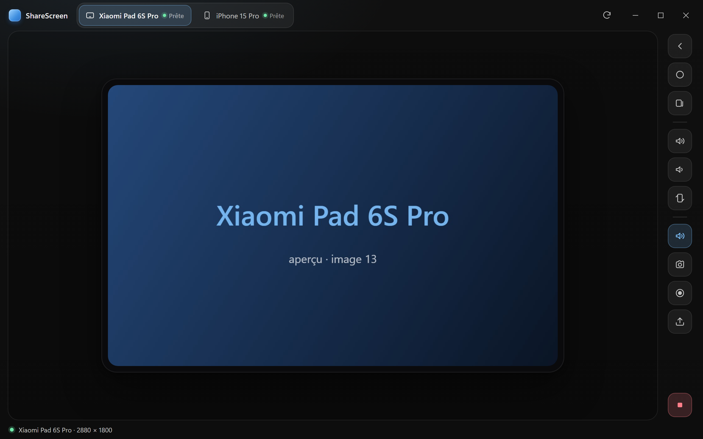
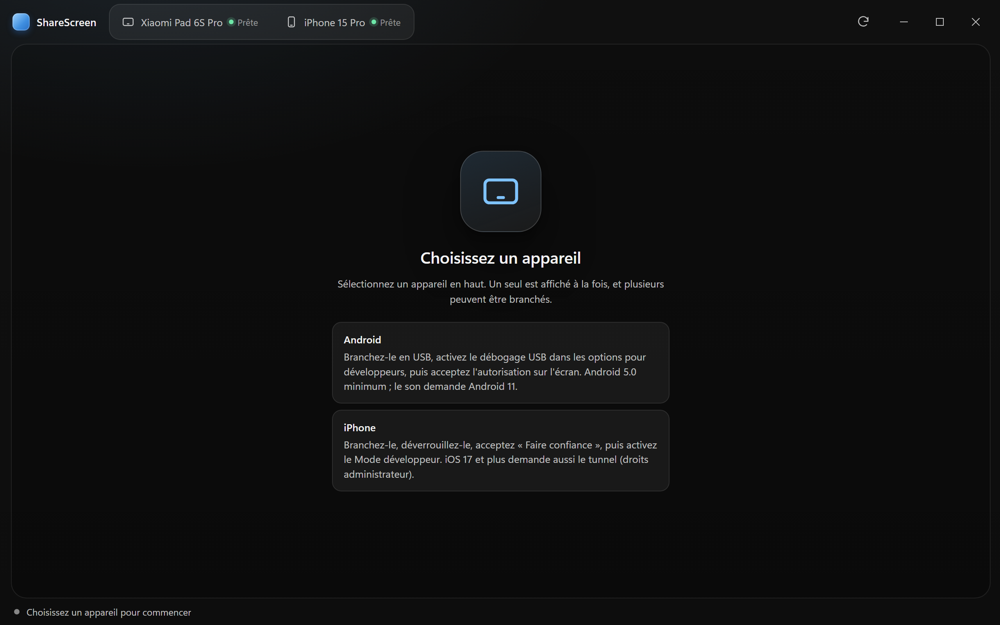
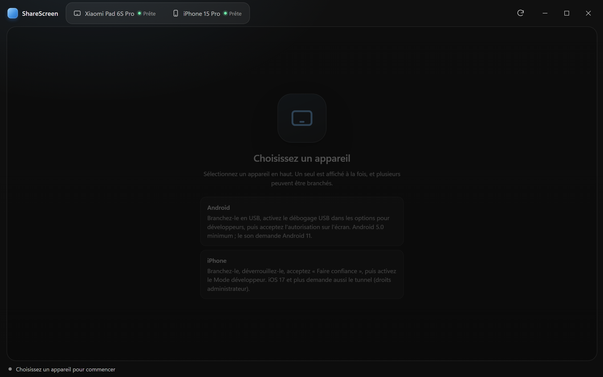
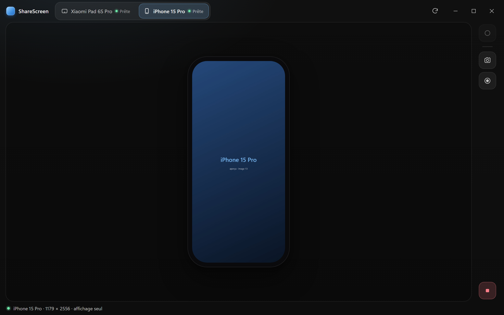

<div align="center">


# ShareScreen

**Affichez et contrôlez l'écran de votre tablette Android ou de votre iPhone sur Windows 11, par câble USB.**

<p>
  <a href="https://github.com/ImShimao/sharescreen/releases/latest"></a>
  <a href="https://github.com/ImShimao/sharescreen/releases"></a>
  <a href="LICENSE"></a>
  
  
  
  
</p>

<p>
  <a href="#-installation"><b>Installation</b></a> ·
  <a href="#-aperçu"><b>Aperçu</b></a> ·
  <a href="#-fonctionnalités"><b>Fonctionnalités</b></a> ·
  <a href="#-préparer-vos-appareils"><b>Préparer les appareils</b></a> ·
  <a href="#-dépannage"><b>Dépannage</b></a> ·
  <a href="#-développement"><b>Développement</b></a>
</p>

</div>

<p align="center">
  
</p>

ShareScreen affiche l'écran de votre appareil dans une fenêtre Windows 11 : vidéo fluide, son de l'appareil, et contrôle à la souris et au clavier pour Android. Une seule fenêtre, un seul appareil affiché à la fois, et plusieurs appareils peuvent être branchés.

---

## 📥 Installation

1. Téléchargez **`ShareScreen_x.y.z_x64-setup.exe`** depuis la page [**Releases**](https://github.com/ImShimao/sharescreen/releases/latest).
2. Lancez l'installeur. Il ne demande aucun droit administrateur.
3. Windows peut afficher « éditeur inconnu » : cliquez sur **Informations complémentaires**, puis **Exécuter quand même**.

Adb, go-ios, le serveur scrcpy et le pilote wintun sont inclus. Aucun autre logiciel n'est à installer.

Les mises à jour sont proposées au lancement (**Mettre à jour** ou **Plus tard**), sans réinstaller.

---

## 🖼️ Aperçu

<table>
  <tr>
    <td width="50%"><br><sub><b>Accueil</b> : choisissez l'appareil, les étapes de connexion sont rappelées.</sub></td>
    <td width="50%"><br><sub><b>iPhone</b> : une checklist claire, avec l'action qui règle chaque point.</sub></td>
  </tr>
  <tr>
    <td width="50%"><br><sub><b>iPhone en direct</b> : affichage en portrait, cadre adapté à l'orientation.</sub></td>
    <td width="50%"><br><sub><b>Barre d'outils</b> : retour, accueil, récentes, volume, rotation, capture, enregistrement, fichiers.</sub></td>
  </tr>
</table>

<sub>Captures prises avec des images de démonstration : aucune donnée personnelle.</sub>

---

## ✨ Fonctionnalités

| | Fonctionnalité | Détails |
| :-: | --- | --- |
| 📺 | **Affichage fluide** | Vidéo H.264 décodée par le matériel de votre PC, jusqu'à 1920 px et 60 images/s. |
| 🔊 | **Son de l'appareil** | Audio Opus transmis au PC (Android 11 et plus). |
| 🖱️ | **Contrôle Android** | Souris, clavier, molette, Retour, Accueil, Récentes, volume, rotation. |
| 📸 | **Captures et vidéos** | Capture PNG et enregistrement WebM, son compris. |
| 📁 | **Fichiers** | Glissez des fichiers dans la fenêtre pour les envoyer ; récupérez ceux de Téléchargements. |
| 🍎 | **iPhone** | Affichage via go-ios, tunnel iOS 17 et plus ; contrôle avec WebDriverAgent. |
| 🔄 | **Mises à jour intégrées** | Vérification au lancement, installation signée. |
| 🪟 | **Interface Windows 11** | Effet Mica, thème clair ou sombre selon le système. |

---

## 📱 Préparer vos appareils

<details>
<summary><b>🤖 Android</b> (Android 5.0 minimum, son à partir d'Android 11)</summary>

1. Ouvrez **Paramètres › À propos** et tapotez plusieurs fois sur le **numéro de version** : les options pour développeurs s'activent.
2. Dans **Options pour développeurs**, activez le **débogage USB**.
3. Branchez l'appareil en USB et acceptez l'**autorisation** affichée à l'écran (cochez « Toujours autoriser »).
4. **Xiaomi, Redmi, POCO** : activez aussi **« Débogage USB (paramètres de sécurité) »**, sinon l'écran s'affiche mais ne répond pas au clavier ni à la souris.

</details>

<details>
<summary><b>🍎 iPhone</b> (toutes versions d'iOS)</summary>

1. Branchez l'iPhone, déverrouillez-le et acceptez **« Faire confiance »**.
2. Activez le **Mode développeur** : *Réglages › Confidentialité et sécurité › Mode développeur*. Si l'option est absente, le bouton **Révéler l'option** l'affiche. L'iPhone redémarre.
3. **iOS 17 et plus** : cliquez sur **Activer le tunnel**. Windows demande une fois les droits administrateur ; ShareScreen installe lui-même le pilote nécessaire.
4. L'image développeur est téléchargée et montée automatiquement une fois (connexion Internet nécessaire).

</details>

---

## 🛠️ Dépannage

| Symptôme | Solution |
| --- | --- |
| La tablette apparaît « Autorisation » | Acceptez le débogage USB sur l'écran de l'appareil, puis actualisez la liste. |
| L'image s'affiche mais le clavier et la souris ne répondent pas (Xiaomi) | Activez « Débogage USB (paramètres de sécurité) ». |
| Pas de son | Vérifiez Android 11 minimum. Certaines applications protégées ne laissent pas capturer leur audio. |
| iPhone : « Certificat signé par une autorité inconnue » | Certains PC n'ont pas les certificats d'Apple. Suivez [docs/certificats-apple.md](docs/certificats-apple.md), une seule fois. |
| iPhone : tunnel inactif | Cliquez sur **Activer le tunnel** et acceptez la fenêtre Windows. |
| iPhone en lecture seule | Normal sans WebDriverAgent : le contrôle demande une installation compilée avec Xcode. |

---

## 🔒 Confidentialité

ShareScreen fonctionne entièrement en local : vos images, vos fichiers et vos sons restent sur votre PC. Le seul contact avec Internet est la vérification des mises à jour sur GitHub, et le téléchargement de l'image développeur iOS par Apple lorsque vous affichez un iPhone.

---

## 🧑‍💻 Développement

### Prérequis

- Windows 11 64 bits
- [Node.js](https://nodejs.org) 22 ou plus récent
- [Rust](https://rustup.rs) : `winget install Rustlang.Rustup`
- Outils de génération C++ de Visual Studio (« Développement desktop en C++ »)

Lancez les commandes depuis **Developer PowerShell for VS 2022**.

### Commandes

```bash
npm install          # dépendances, puis téléchargement vérifié de adb, go-ios, scrcpy et wintun
npm run dev          # application en développement
npm test             # tests Rust : protocole, décodage, compatibilité
npm run typecheck    # types de l'interface
npm run build        # installeur dans src-tauri/target/release/bundle/nsis
npm run release      # installeur signé et latest.json (voir ci-dessous)
```

### Architecture

| Fichier | Rôle |
| --- | --- |
| [`src-tauri/src/protocol.rs`](src-tauri/src/protocol.rs) | Parseurs du flux scrcpy 5.0.1 et encodeurs des messages de contrôle |
| [`src-tauri/src/android.rs`](src-tauri/src/android.rs) | Session Android : serveur, sockets vidéo, audio et contrôle |
| [`src-tauri/src/ios.rs`](src-tauri/src/ios.rs) | iPhone : go-ios, flux MJPEG, tunnel, WebDriverAgent |
| [`src-tauri/src/devices.rs`](src-tauri/src/devices.rs) | Règles de compatibilité par version Android et iOS |
| [`src-tauri/src/adb.rs`](src-tauri/src/adb.rs) | Wrapper autour d'adb.exe |
| [`src/renderer/src/App.tsx`](src/renderer/src/App.tsx) | Interface principale |
| [`src/renderer/src/lib/backend.ts`](src/renderer/src/lib/backend.ts) | Pont entre l'interface et le backend Tauri |
| [`scripts/fetch-binaries.mjs`](scripts/fetch-binaries.mjs) | Téléchargement des outils externes, vérifié par SHA-256 |
| [`scripts/make-latest.mjs`](scripts/make-latest.mjs) | Génération de `latest.json` pour les mises à jour |

### Publier une version

1. Mettez à jour le numéro de version dans `package.json` et `src-tauri/tauri.conf.json`.
2. Définissez la clé de signature, puis lancez `npm run release`.
3. Créez une release GitHub `vX.Y.Z` avec l'installeur `.exe` et `latest.json`.

<details>
<summary><b>🔑 Clé de signature des mises à jour</b></summary>

La clé privée se trouve dans `C:\Users\<vous>\.tauri\sharescreen.key`. Sauvegardez-la hors du projet : sans elle, les installations existantes ne pourront plus se mettre à jour. Ne la publiez jamais.

```powershell
$env:TAURI_SIGNING_PRIVATE_KEY = "$env:USERPROFILE\.tauri\sharescreen.key"
$env:TAURI_SIGNING_PRIVATE_KEY_PASSWORD = ""
npm run release
```

Pour un fork, générez votre propre clé (`npx tauri signer generate`), remplacez `plugins.updater.pubkey` et l'adresse `plugins.updater.endpoints` dans `src-tauri/tauri.conf.json`.

</details>

---

## ⚠️ Limites connues

- Le contrôle de l'iPhone exige WebDriverAgent, compilé avec Xcode : sans lui, l'affichage est en lecture seule.
- Le son de l'iPhone n'est pas pris en charge sur Windows.
- Le son Android dépend de l'application lue : certaines applications protégées refusent la capture.

---

## 🤝 Remerciements

Ce projet s'appuie sur [scrcpy](https://github.com/Genymobile/scrcpy), [go-ios](https://github.com/danielpaulus/go-ios), les platform-tools d'Android, [wintun](https://www.wintun.net) et [Tauri](https://tauri.app).

## 📄 Licence

Distribué sous licence [Apache-2.0](LICENSE). Les outils tiers gardent leurs propres licences, détaillées dans [NOTICE](NOTICE).
