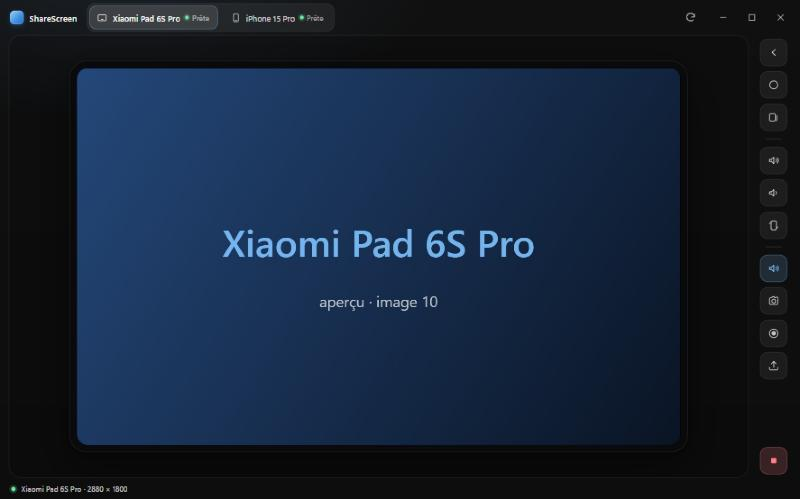
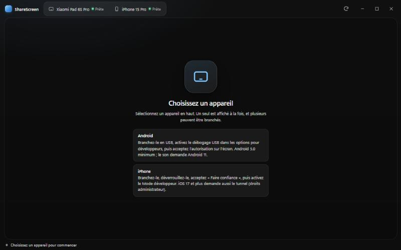
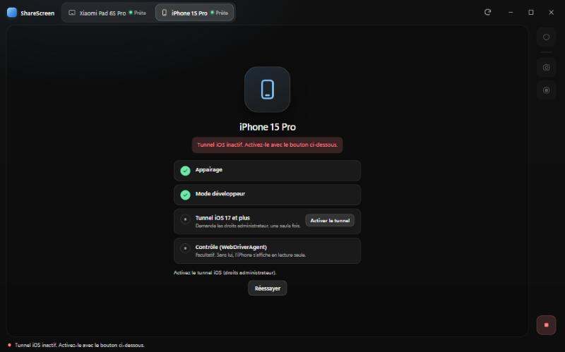
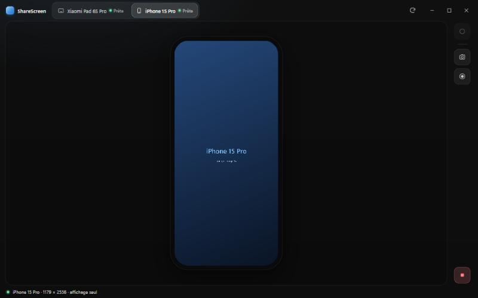

<div align="center">


# ShareScreen

**Affichez l'écran de votre tablette Android ou de votre iPhone sur votre PC Windows 11.**
Son, souris et clavier (Android), par câble USB. Une seule fenêtre, un seul appareil à la fois.

<p>
  
  
  
  
  
  
  
  
</p>

<p>
  <a href="#-installation"><b>Installer</b></a> ·
  <a href="#-aperçu"><b>Aperçu</b></a> ·
  <a href="#-fonctionnalités"><b>Fonctionnalités</b></a> ·
  <a href="#-préparer-vos-appareils"><b>Préparer les appareils</b></a> ·
  <a href="#-développer"><b>Développer</b></a>
</p>

</div>

---

## 🖼️ Aperçu

<p align="center">
  
</p>

<table>
  <tr>
    <td width="50%"><br><sub><b>Accueil</b> : choisissez l'appareil à afficher, les étapes de connexion sont rappelées.</sub></td>
    <td width="50%"><br><sub><b>iPhone</b> : une checklist claire, avec l'action qui règle chaque point.</sub></td>
  </tr>
  <tr>
    <td width="50%"><br><sub><b>iPhone en direct</b> : affichage en portrait, cadre adapté à l'orientation.</sub></td>
    <td width="50%"><br><sub><b>Barre d'outils</b> : retour, accueil, récentes, volume, rotation, capture, enregistrement, fichiers.</sub></td>
  </tr>
</table>

> Captures d'écran avec des images de démonstration : aucune donnée personnelle.

---

## ✨ Fonctionnalités

| | |
| --- | --- |
| 📺 **Affichage fluide** | Vidéo H.264 décodée par le matériel de votre PC (WebCodecs), jusqu'à 1920 px et 60 images/s. |
| 🔊 **Son de l'appareil** | Audio Opus transmis au PC (Android 11 et plus). |
| 🖱️ **Contrôle Android** | Souris, clavier, molette, touches Retour, Accueil, Récentes, volume et rotation. |
| 📸 **Captures et vidéos** | Capture PNG et enregistrement WebM de ce qui est affiché, son compris. |
| 📁 **Fichiers** | Glissez des fichiers dans la fenêtre pour les envoyer ; récupérez ceux de Téléchargements. |
| 🍎 **iPhone** | Affichage via go-ios et tunnel iOS 17+ ; contrôle si WebDriverAgent est installé. |
| 🔄 **Mises à jour** | Proposées au lancement (« Mettre à jour » ou « Plus tard »), sans réinstallation. |
| 🪟 **Interface Windows 11** | Effet Mica, thème clair ou sombre selon votre système. |

---

## 📦 Installation

1. Téléchargez **`ShareScreen_x.y.z_x64-setup.exe`** depuis la page [**Releases**](https://github.com/ImShimao/sharescreen/releases).
2. Lancez-le et suivez l'installation. Il n'exige aucun droit administrateur.
3. Windows peut afficher un avertissement (éditeur inconnu) : cliquez sur **Informations complémentaires**, puis **Exécuter quand même**.

Adb, go-ios et le serveur scrcpy sont inclus. Aucun autre logiciel n'est nécessaire.

---

## 📱 Préparer vos appareils

<details>
<summary><b>🤖 Tablette ou téléphone Android</b> (Android 5.0 minimum, son à partir d'Android 11)</summary>

1. Ouvrez **Paramètres › À propos**, puis tapotez plusieurs fois sur le **numéro de version** : les options pour développeurs s'activent.
2. Dans **Options pour développeurs**, activez le **débogage USB**.
3. Branchez l'appareil en USB et acceptez l'**autorisation** affichée à l'écran (cochez « Toujours autoriser »).
4. **Xiaomi, Redmi, POCO** : activez aussi **« Débogage USB (paramètres de sécurité) »**, sinon l'écran s'affiche mais ne répond pas au clavier ni à la souris.

</details>

<details>
<summary><b>🍎 iPhone</b> (toutes versions d'iOS)</summary>

1. Branchez l'iPhone, déverrouillez-le et acceptez **« Faire confiance »**. Le bouton *Demander l'appairage* peut relancer la demande.
2. Activez le **Mode développeur** : *Réglages › Confidentialité et sécurité › Mode développeur*. Si l'option est absente, le bouton *Révéler l'option* l'affiche. L'iPhone redémarre.
3. **iOS 17 et plus** : cliquez sur **Activer le tunnel**. Windows demande une fois les droits administrateur ; ShareScreen installe lui-même le pilote nécessaire.
4. L'image développeur est téléchargée et montée automatiquement une fois (connexion Internet nécessaire).

> **Contrôle de l'iPhone** : il demande [WebDriverAgent](https://github.com/appium/WebDriverAgent) installé sur l'appareil, compilé avec Xcode. Sans lui, l'iPhone s'affiche en lecture seule.

</details>

<details>
<summary><b>🔐 « Certificat signé par une autorité inconnue » sur l'iPhone</b></summary>

Certains PC n'ont pas les certificats d'Apple dans Windows. L'app l'indique à l'écran. Le correctif est à faire une seule fois : voir [docs/certificats-apple.md](docs/certificats-apple.md).

</details>

---

## 🛠️ Développer

### Prérequis

- Windows 11 64 bits
- [Node.js](https://nodejs.org) 22 ou plus récent
- [Rust](https://rustup.rs) : `winget install Rustlang.Rustup`
- Outils de génération C++ de Visual Studio (« Développement desktop en C++ »)

Lancez les commandes depuis **Developer PowerShell for VS 2022**, qui charge l'environnement de compilation.

### Commandes

```bash
npm install          # installe les dépendances et télécharge adb, go-ios, scrcpy et wintun (SHA-256 vérifiés)
npm run dev          # lance l'application en développement
npm test             # tests Rust : protocole, décodage, règles de compatibilité
npm run typecheck    # types de l'interface
npm run build        # installeur dans src-tauri/target/release/bundle/nsis
```

### Architecture

| Fichier | Rôle |
| --- | --- |
| [`src-tauri/src/protocol.rs`](src-tauri/src/protocol.rs) | Parseurs du flux scrcpy 5.0.1 et encodeurs des messages de contrôle |
| [`src-tauri/src/android.rs`](src-tauri/src/android.rs) | Session Android : serveur scrcpy, sockets vidéo, audio et contrôle |
| [`src-tauri/src/ios.rs`](src-tauri/src/ios.rs) | iPhone : go-ios, flux MJPEG, tunnel, client WebDriverAgent |
| [`src-tauri/src/devices.rs`](src-tauri/src/devices.rs) | Règles de compatibilité par version Android et iOS |
| [`src-tauri/src/adb.rs`](src-tauri/src/adb.rs) | Wrapper autour d'adb.exe |
| [`src/renderer/src/App.tsx`](src/renderer/src/App.tsx) | Interface principale |
| [`src/renderer/src/lib/backend.ts`](src/renderer/src/lib/backend.ts) | Pont entre l'interface et le backend Tauri |
| [`scripts/fetch-binaries.mjs`](scripts/fetch-binaries.mjs) | Téléchargement vérifié des outils externes |
| [`scripts/make-latest.mjs`](scripts/make-latest.mjs) | Génération de `latest.json` pour les mises à jour |

### Publier une version

1. Mettez à jour le numéro de version dans `package.json` et `src-tauri/tauri.conf.json`.
2. Définissez la clé de signature (voir ci-dessous), puis lancez `npm run release`. Cela compile l'installeur signé et génère `latest.json`.
3. Créez une release GitHub `vX.Y.Z` et joignez l'installeur `.exe` et `latest.json`.

Le dépôt de mise à jour est fixé dans `src-tauri/tauri.conf.json` (`plugins.updater.endpoints`). Si vous forkez le projet, remplacez `ImShimao/sharescreen` par le vôtre.

<details>
<summary><b>🔑 Clé de signature des mises à jour</b></summary>

La clé privée se trouve dans `C:\Users\<vous>\.tauri\sharescreen.key`. Sauvegardez-la hors du projet : sans elle, les versions déjà installées ne pourront plus être mises à jour. Ne la publiez jamais (le `.gitignore` l'exclut).

```powershell
$env:TAURI_SIGNING_PRIVATE_KEY = "$env:USERPROFILE\.tauri\sharescreen.key"
$env:TAURI_SIGNING_PRIVATE_KEY_PASSWORD = ""
npm run release
```

Si vous forkez le projet, générez votre propre clé (`npx tauri signer generate`) et remplacez `plugins.updater.pubkey` par la clé publique générée. Sans cela, les mises à jour de votre fork ne seront pas acceptées par les installations existantes.

</details>

---

## ⚠️ Limites connues

- Le contrôle de l'iPhone dépend de WebDriverAgent (compilé avec Xcode) et reste plus lent que celui de la tablette.
- Le son de l'iPhone n'est pas pris en charge sur Windows.
- Le son Android dépend de l'application : certaines applications protégées ne laissent pas capturer leur audio.
- Captures et enregistrements portent sur l'image affichée (WebM et PNG).

---

## 📄 Licence

Licence du projet : [Apache-2.0](LICENSE). Les outils tiers gardent leurs propres licences : voir [NOTICE](NOTICE).
